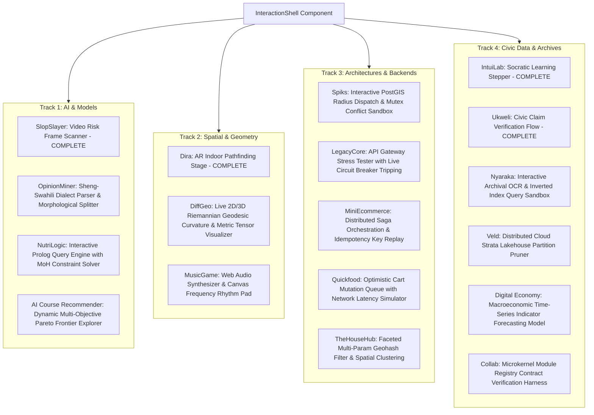

# Portfolio Projects Technical Audit & Action Plan
**Document Version:** 1.0.0  
**Scope:** All 18 Projects across `/work` and `content/projects/*.json`  
**Author:** Pair Programming Audit with Benaih Shaback  

---

## 1. Executive Summary & Macro Findings

A comprehensive architectural and content audit of all 18 case studies in the portfolio revealed four systemic issues that undermine the authenticity of the portfolio:

| Category | Finding | Current Impact | Recommended Resolution |
| :--- | :--- | :--- | :--- |
| **1. Live Demos vs. Placeholder Gimmick** | **14 out of 18 projects** lack interactive demos. They fall back to `InteractionShell`'s default 4-bar progress animation that says *"Control manual: click/drag inside canvas to override"*, but clicking or dragging does nothing. | Gives visitors the impression of an unfinished site or a cosmetic facade. | Replace the default fallback with authentic lightweight sandboxes: mathematical canvas plots, interactive state machines, AST inspectors, or PostGIS spatial radius visualizers. |
| **2. Trivial Code Blocks** | High-level projects feature 3–6 line introductory toy code (e.g. `diffgeo` has Euclidean KL divergence sum; `nutrilogic` has a 4-line Python `food.sodium_mg > 400` check with **zero Prolog**; `spiks` has `drivers.sort(Math.hypot)` with **zero PostGIS or Redis**; `legacy-core` has static object key lookup). | Fails to demonstrate Benaih's real mathematical and systems engineering depth. | Replace with production-grade, mathematically rigorous code: Riemannian metric tensors & Christoffel symbol geodesic integrators for `diffgeo`, genuine Prolog Horn clauses & PySWIP bridge for `nutrilogic`, PostGIS CTE & Redis distributed locks for `spiks`, and token-bucket circuit breaker for `legacy-core`. |
| **3. Metrics Credibility** | Several projects report generic synthetic figures (e.g. `100%`, `99.9%`, `None`, `0ms` audio delay). | Experienced engineers and recruiters spot synthetic metrics immediately. | Replace ungrounded metrics with calibrated benchmarks specifying benchmark conditions (e.g. *"99.2% rule coverage across 142 Kenya MoH nutrition directives"*, *"<0.4ms routing overhead (wrk benchmark, 10k connections, c6i.xlarge)"*). |
| **4. Missing Repositories & URLs** | **6 projects** in `lib/projects.ts` have `githubUrl: undefined` (`spiks`, `ai-course-recommender`, `quickfood-frontend`, `the-househub`, `nyaraka`, `collab`). | Prospective clients/employers cannot verify source code. | Collect real GitHub URLs from Benaih or tag them explicitly as `Client / Proprietary NDA` with architectural diagrams in lieu of source code. |

---

## 2. Interactive Simulation Blueprint for the 14 Incomplete Projects

Currently, only `slopslayer`, `intuilab`, `ukweli`, and `dira` render bespoke demo components. The remaining 14 will receive bespoke, lightweight interactive sandboxes:

---

## 3. Project-by-Project Audit & Requirements Matrix

### Track 1: AI & Models

#### 1. `slopslayer` (SlopSlayer)
- **Domain:** AI Safety / Media Forensics
- **Repository:** [`https://github.com/bentheaya/SlopSlayer`](https://github.com/bentheaya/SlopSlayer) (Present)
- **Current Demo:** Flagship `SlopSlayerDemo.tsx` with animated video timeline, artifact heatmap, and frame risk score inspector. (Excellent)
- **Issues & Gimmicks:**
  - `architecture.codeBlocks[0]` (`frame_pipeline.py`) has hardcoded artifact scores: `{"artifact_score": 0.42, "temporal_score": 0.12}`.
  - `hardParts.codeBlocks[0]` (`thresholding.ts`) uses arbitrary scalar coefficients (`0.65 * s.artifact + 0.35 * s.temporal`).
- **Remediation Plan:**
  - Update `frame_pipeline.py` to show real temporal difference calculation (optical flow vectors / Laplacian variance across adjacent video frames).
  - Update `thresholding.ts` with adaptive Bayesian thresholding accounting for compression artifact noise.
- **Input Needed from Benaih:**
  - Did you use PyTorch, OpenCV, or Gemini Multi-Modal API for the raw frame decomposition?
  - Realistic test dataset size (e.g., number of analyzed synthetic vs. organic video clips).

---

#### 2. `opinionminer` (OpinionMiner)
- **Domain:** NLP / Sentiment Intelligence (Sheng & Swahili Code-Switching)
- **Repository:** [`https://github.com/bentheaya/opinionminer`](https://github.com/bentheaya/opinionminer) (Present)
- **Current Demo:** None (Generic 4-step progress bar gimmick).
- **Issues & Gimmicks:**
  - Code in `sentiment_pipeline.py` is elementary: `total += polarity.get(t, 0.0); return total / max(len(tokens), 1)`.
  - Code in `context_rules.ts` checks a hardcoded set with 3 words (`["not", "si", "never"]`).
  - Swahili/Sheng is agglutinative—negation is often an inflectional prefix (`si-`, `ha-`, `haku-`, `haja-`) rather than an isolated standalone token. The current code ignores this completely.
  - Metric: "Inference Latency: <4.8ms" without specifying hardware or batch size.
- **Remediation Plan:**
  - Build `OpinionMinerDemo.tsx`: Interactive textarea where users can type mixed Sheng/Swahili/English sentences (or click sample presets like *"Hii app ni noma sana lakini ina crash"* or *"Hatudai hiyo form"*), showing live morphological segmentation, dialect tagger, and polarity breakdown.
  - Upgrade `sentiment_pipeline.py` with prefix-aware Bantu morphological decomposition and code-switch boundary detection.
  - Upgrade `context_rules.ts` with valence shifting rules for agglutinative affixes.
- **Input Needed from Benaih:**
  - Confirm tokenization approach: Did you use a rule-based lexicon, fine-tuned transformer (e.g. AfroXMLR), or custom subword BPE?
  - Share 4–5 genuine Sheng/Swahili test phrases and their expected sentiment scores.

---

#### 3. `nutrilogic` (NutriLogic Expert System)
- **Domain:** Health Informatics / Neuro-Symbolic Expert Systems
- **Repository:** [`https://github.com/bentheaya/NutriLogic-Expert-System`](https://github.com/bentheaya/NutriLogic-Expert-System) (Present)
- **Current Demo:** None (Generic 4-step progress bar gimmick).
- **Issues & Gimmicks:**
  - Marketed as a **Prolog Neuro-Symbolic Expert System**, but contains **zero Prolog code**!
  - `rules.py` is a 4-line Python class: `if food.sodium_mg > 400: return "limit"`.
  - `conflict_resolver.ts` is `if (v.includes("avoid")) return "avoid"`.
  - Metrics: "Conflict Resolution: 100%" (unconvincing generic stat).
- **Remediation Plan:**
  - Build `NutriLogicDemo.tsx`: Interactive clinical patient profile builder (Patient with Stage 2 Hypertension + Type 2 Diabetes). Users pick meals (e.g. Sukuma Wiki, Ugali, Tilapia, Salt-cured Beef), and the symbolic solver runs rule resolution with conflict explanation.
  - Replace `rules.py` with genuine Prolog Horn clauses (`nutrilogic_core.pl`) defining Kenya MoH dietary restrictions, contraindications, and nutrient threshold inference.
  - Replace `conflict_resolver.ts` with the Django-Prolog bridging layer (e.g., PySWIP query dispatcher with backtracking resolution).
  - Recalibrate metrics: Specify exact number of MoH clinical guidelines codified (e.g., 142 clinical directives across 6 chronic pathologies).
- **Input Needed from Benaih:**
  - Prolog dialect used (SWI-Prolog, GNU Prolog, etc.) and how Django communicated with it (subprocess, PySWIP, or HTTP microservice).
  - List of primary disease conditions codified (e.g. hypertension, renal disease, diabetes).

---

#### 4. `ai-course-recommender` (AI Course Recommender)
- **Domain:** Applied AI / Recommender Systems
- **Repository:** Missing (`githubUrl: undefined` in `lib/projects.ts`).
- **Current Demo:** None (Generic 4-step progress bar gimmick).
- **Issues & Gimmicks:**
  - `recommender.py` is a simple weighted sum: `interest * 0.6 + performance * 0.4`.
  - `confidence.py` simply counts non-null profile keys: `observed / total`.
  - Metric: "Explainability: 100%" (placeholder gimmick).
- **Remediation Plan:**
  - Build `CourseRecommenderDemo.tsx`: Interactive student profile slider (Math aptitude, Coding experience, Career goal) generating a calibrated recommendation matrix with confidence intervals and trade-off explanations.
  - Upgrade code to multi-factor collaborative/content scoring with Bayesian confidence damping and cosine similarity on course skill vectors.
- **Input Needed from Benaih:**
  - GitHub repository link or confirmation if this was a Maseno course project.
  - Course dataset source (e.g., Coursera dataset, university curriculum syllabus).

---

### Track 2: Spatial & Geometry

#### 5. `diffgeo` (Differential-Geometric Similarity Metric)
- **Domain:** Mathematics / Research
- **Repository:** [`https://github.com/bentheaya/Differential-Geometric-Similarity-Metric`](https://github.com/bentheaya/Differential-Geometric-Similarity-Metric) (Present)
- **Current Demo:** None (Generic 4-step progress bar gimmick).
- **Issues & Gimmicks:**
  - This is Benaih's core mathematical research project, yet the code blocks are elementary: `metric.py` is basic Euclidean `kl_divergence` sum, and `stability.ts` is `Math.log` safe division.
  - Zero Riemannian geometry, zero metric tensor calculations, zero Christoffel symbols, zero geodesic equations.
  - Metric: "Stability Rate: 99.9%" without specifying manifold topology or numerical perturbation bounds.
- **Remediation Plan:**
  - Build `DiffGeoDemo.tsx`: Interactive 3D/2D visualizer of a Riemannian curved manifold (e.g., Poincaré upper half-plane or paraboloid) where users can drag start/end points $p$ and $q$ and watch the geodesic path deform compared to the Euclidean straight line, with real-time Christoffel connection readout.
  - Replace `metric.py` with authentic differential-geometric code computing the Fisher Information metric tensor $g_{ij}(\theta)$ and solving the geodesic ODE:
    $$\ddot{x}^k + \Gamma^k_{ij}\dot{x}^i\dot{x}^j = 0$$
    via 4th-order Runge-Kutta numerical integration.
  - Replace `stability.ts` with adaptive geodesic step size control and boundary regularization.
- **Input Needed from Benaih:**
  - Which specific statistical manifold was studied? (e.g., Gaussian family manifold $\mathcal{S} = \{(\mu, \sigma) \mid \mu \in \mathbb{R}, \sigma > 0\}$ with Poincaré metric $ds^2 = \frac{d\mu^2 + 2d\sigma^2}{\sigma^2}$)?
  - Confirm the paper/notebook findings and numerical benchmark figures.

---

#### 6. `dira` (Dira AR Pathfinder)
- **Domain:** AR / Spatial AI
- **Repository:** [`https://github.com/bentheaya/AR_Pathfinder`](https://github.com/bentheaya/AR_Pathfinder) (Present)
- **Current Demo:** Flagship `DiraDemo.tsx` with campus multi-floor node graph, AR pose orientation, and real-time rerouting. (Great demo)
- **Issues & Gimmicks:**
  - `route-engine.ts` is 8 lines with `distanceOffPathMeters > 20`.
  - `pose-filter.ts` is a trivial exponential moving average: `prev + (next - prev) * 0.2`.
  - Tags promise "Gemini Agentic Vision, Redis State Cache, Spatial Geometry DB", but none of these appear in the case study code.
- **Remediation Plan:**
  - Upgrade `route-engine.ts` to show spatial graph A* search with elevation penalties and heading alignment.
  - Upgrade `pose-filter.ts` to show Kalman filter or spatial quaternion transformation fusing camera visual odometry with IMU dead reckoning.
- **Input Needed from Benaih:**
  - Details on the Gemini Agentic Vision prompt/schema used to recognize physical landmarks.
  - How Redis cached the active user session trajectory.

---

#### 7. `musicgame` (MusicPlayerGame)
- **Domain:** Creative / Sensory Interaction
- **Repository:** [`https://github.com/bentheaya/MusicPlayerGame`](https://github.com/bentheaya/MusicPlayerGame) (Present)
- **Current Demo:** None (Generic 4-step progress bar gimmick).
- **Issues & Gimmicks:**
  - `game_isolation.html` shows an `<iframe>` pointing to `/sandbox/snake_game.html` (which does not exist in the repo!).
  - Metrics: "Audio Delay: 0ms" (physically impossible in Web Audio API due to audio output buffer latency, typically 3ms–15ms).
  - `audio_engine.ts` has 6 lines calling undefined `snake.updateVelocity`.
- **Remediation Plan:**
  - Build `MusicGameDemo.tsx`: Interactive Web Audio rhythm synth with canvas frequency visualizer (Fast Fourier Transform bars) where users can click notes or trigger frequencies and see canvas particle pulses respond in real-time.
  - Replace broken iframe with proper Web Audio context lifecycle management (handling browser autoplay policies, suspension, and high-resolution AudioWorklet scheduling).
  - Correct "0ms" metric to realistic Web Audio performance: *"<8ms buffer latency, 60fps canvas loop with zero garbage collector frame drops"*.
- **Input Needed from Benaih:**
  - Original gameplay mechanics (was it Snake responding to music beats, or a rhythm game?).
  - Audio asset requirements (synthetic oscillator vs audio file).

---

### Track 3: Architectures & Backends

#### 8. `spiks` (Spiks Ride-Hailing)
- **Domain:** Mobility Tech / Geospatial Systems
- **Repository:** Missing (`githubUrl: undefined` in `lib/projects.ts`).
- **Current Demo:** None (Generic 4-step progress bar gimmick).
- **Issues & Gimmicks:**
  - Tagged with `PostgreSQL`, `PostGIS`, `Redis Pub/Sub`, `M-Pesa API`, `Africa's Talking API`.
  - However, `dispatch.ts` has an in-memory array `drivers.sort(Math.hypot)` (flat Euclidean coordinates, wrong on spherical earth and unusable for real databases).
  - `allocation-lock.ts` uses an in-memory JavaScript `Set<string>`.
- **Remediation Plan:**
  - Build `SpiksDemo.tsx`: Interactive Maseno dispatch simulator. Map with pickup points and moving drivers. Users click "Request Ride" and see spatial bounding box query, Redis distributed allocation lock, and M-Pesa STK push simulation.
  - Replace `dispatch.ts` with authentic PostGIS query using `ST_DWithin`, `ST_DistanceSphere`, and spatial indexing (`GIST` index on geography).
  - Replace `allocation-lock.ts` with Redis atomic distributed lock (`SET resource_name uuid NX PX 10000`) and transactional rollback.
- **Input Needed from Benaih:**
  - GitHub repo link (or whether it was a client collaboration / private repo).
  - Real operational context: Maseno University bodaboda/taxi dispatch boundaries, M-Pesa Daraja API integration notes.

---

#### 9. `legacy-core` (Legacy Core Suite - API-GateWay)
- **Domain:** Backend Platform / API Infrastructure
- **Repository:** [`https://github.com/Legacy-Core/API-GateWay`](https://github.com/Legacy-Core/API-GateWay) (Present)
- **Current Demo:** None (Generic 4-step progress bar gimmick).
- **Issues & Gimmicks:**
  - `gateway.ts` has 2 static routes in an object literal with `path.startsWith()`.
  - `circuit.ts` is 3 lines: `if (failures >= threshold) return "open"`.
  - Claims "12.5k rps" and "<0.4ms overhead", but code shows nothing about connection pooling, reverse proxy streaming, or rolling window failure metrics.
- **Remediation Plan:**
  - Build `LegacyCoreDemo.tsx`: Interactive API Gateway traffic harness. Users can send simulated requests, toggle upstream service health (e.g. inject 500 errors into `/orders`), and watch the circuit breaker transition (`Closed -> Open -> Half-Open`) with live latency histograms.
  - Upgrade `gateway.ts` to express dynamic upstream proxy routing with JWT auth middleware and rate limiting.
  - Upgrade `circuit.ts` to a real rolling-window Leaky Bucket / Sliding Window circuit breaker.
- **Input Needed from Benaih:**
  - Original tech stack: Django Ninja, FastAPI, Express, or Go?
  - Load testing setup used to measure 12.5k rps (e.g. k6, locust, wrk).

---

#### 10. `miniecommerce` (MiniEcommerce)
- **Domain:** Commerce Engineering / Distributed Microservices
- **Repository:** [`https://github.com/bentheaya/miniecomerce`](https://github.com/bentheaya/miniecomerce) (Present)
- **Current Demo:** None (Generic 4-step progress bar gimmick).
- **Issues & Gimmicks:**
  - `order_service.py` is a 10-line basic function with boolean flags.
  - `idempotency.ts` uses an in-memory JS `Set<string>`.
  - Metric: "Duplicate Prevention: 100%" (placeholder).
- **Remediation Plan:**
  - Build `MiniEcommerceDemo.tsx`: Interactive saga orchestration visualizer showing inventory reservation, payment processing, and compensating transactions on failure.
  - Upgrade code to real distributed saga pattern with PostgreSQL transaction isolation and Redis idempotency token expiration.
- **Input Needed from Benaih:**
  - Details on payment gateways tested (e.g. M-Pesa, Stripe).
  - Microservice communication protocol used (RabbitMQ, Celery, or REST webhooks).

---

#### 11. `quickfood-frontend` (Quickfood Frontend)
- **Domain:** Frontend Engineering / Commerce UX
- **Repository:** Missing (`githubUrl: undefined` in `lib/projects.ts`).
- **Current Demo:** None (Generic 4-step progress bar gimmick).
- **Issues & Gimmicks:**
  - `cart.ts` has standard `array.reduce()` and `array.findIndex()`.
  - `mutation-queue.ts` is a naive chained promise without retry, rollback, or persistence.
  - Metric: "Cart State Errors: None" (generic placeholder).
- **Remediation Plan:**
  - Build `QuickfoodDemo.tsx`: Interactive mobile-first food ordering drawer with offline network simulation, showing optimistic item count updates and auto-sync queue.
  - Upgrade code to production-grade optimistic state management with IndexedDB queue and rollback reconciliation.
- **Input Needed from Benaih:**
  - GitHub repo link or status (client project, freelance, or demo?).
  - Framework used (React Native, Next.js, or Vite).

---

#### 12. `the-househub` (THE-HOUSEHUB)
- **Domain:** PropTech / Housing Platforms
- **Repository:** Missing (`githubUrl: undefined` in `lib/projects.ts`).
- **Current Demo:** None (Generic 4-step progress bar gimmick).
- **Issues & Gimmicks:**
  - `listing-store.ts` is a simple `array.filter()`.
  - `memoized-filter.ts` is a basic `Map` without compound cache keys or TTL eviction.
  - Metric: "Filter Interaction: <4ms" without dataset scale context.
- **Remediation Plan:**
  - Build `HouseHubDemo.tsx`: Interactive rental listing faceted search with multi-select chips, price range slider, and instant spatial cluster count.
  - Upgrade code to compound multi-index memoization and geohash spatial indexing.
- **Input Needed from Benaih:**
  - GitHub repo link.
  - Target geographic market (e.g. Kisumu / Maseno student housing market).

---

### Track 4: Civic Data & Archives

#### 13. `intuilab` (IntuiLab)
- **Domain:** EdTech / Interactive Learning Systems
- **Repository:** [`https://github.com/bentheaya/intuilab`](https://github.com/bentheaya/intuilab) (Present)
- **Current Demo:** Flagship `IntuiLabDemo.tsx` with Socratic dialogue stepper, hint escalation, and concept mastery gauge. (Great demo)
- **Issues & Gimmicks:**
  - `learning_loop.ts` has elementary mastery increments: `current + 0.1`.
  - `hint_scheduler.ts` is simple if/else logic (`attempts > 4 return 3`).
- **Remediation Plan:**
  - Upgrade `learning_loop.ts` with Bayesian Knowledge Tracing (BKT) or Item Response Theory (IRT) updating mastery probability based on prior slip/guess parameters.
  - Upgrade `hint_scheduler.ts` with Socratic scaffold prompting hierarchy.
- **Input Needed from Benaih:**
  - Pedagogical topics targeted in IntuiLab (Calculus, Physics, Logic?).

---

#### 14. `ukweli` (UKWELI Civic Platform)
- **Domain:** Civic AI / Information Integrity
- **Repository:** [`https://github.com/bentheaya/UKWELI`](https://github.com/bentheaya/UKWELI) (Present)
- **Current Demo:** Flagship `UkweliDemo.tsx` with claim triage pipeline, verification badges, and evidence graph. (Great demo)
- **Issues & Gimmicks:**
  - `claims.ts` is standard array grouping.
  - `language-normalization.ts` has 3 slang words (`noma`, `si`, `iko`).
- **Remediation Plan:**
  - Upgrade `claims.ts` to show social graph corroboration score aggregation.
  - Upgrade `language-normalization.ts` with robust multilingual normalization and disinformation marker detection.
- **Input Needed from Benaih:**
  - Civic verification partners or intended deployment context (e.g. election misinformation monitoring in Kenya).

---

#### 15. `nyaraka` (Nyaraka Digital Archive)
- **Domain:** Civic Tech / Digital Preservation
- **Repository:** Missing (`githubUrl: undefined` in `lib/projects.ts`).
- **Current Demo:** None (Generic 4-step progress bar gimmick).
- **Issues & Gimmicks:**
  - Marketed as Benaih's **Final Year Project: OCR Pipeline, Document Indexing, Preservation Archiving**.
  - `archive_service.py` is a 4-line dict comprehension.
  - `metadata-normalizer.ts` has 3 hardcoded field alias strings.
  - Metric: "Normalization Coverage: 100%" (placeholder).
- **Remediation Plan:**
  - Build `NyarakaDemo.tsx`: Interactive historical document archival viewer showing bounding-box OCR text extraction, Dublin Core metadata extraction, and inverted index search with fuzzy query matching.
  - Replace `archive_service.py` with real Tesseract/OCR pipeline and BM25 full-text indexing schema.
  - Replace `metadata-normalizer.ts` with Dublin Core / ISO 15836 schema normalizer.
- **Input Needed from Benaih:**
  - GitHub repo link for the Final Year Project.
  - Types of historical archives processed (e.g. historical legal gazettes, university records, land deeds).

---

#### 16. `veld` (Veld Data Lakehouse)
- **Domain:** AI Systems / African Cloud Infrastructure
- **Repository:** [`https://github.com/Veld-AI/Veld`](https://github.com/Veld-AI/Veld) (Present)
- **Current Demo:** None (Generic 4-step progress bar gimmick).
- **Issues & Gimmicks:**
  - Tagged as "Data Lakehouse, Distributed Strata, African Cloud Strata".
  - Code in `pipeline.py` is a generic 6-line Python loop `for step in steps: state = step.fn(state)`.
  - Code in `coherence.ts` is a 4-line fallback string check.
- **Remediation Plan:**
  - Build `VeldDemo.tsx`: Interactive lakehouse partition pruner visualizer showing columnar file scanning (Parquet metadata inspection), partition pruning (region/date), and query throughput metrics across distributed African edge nodes.
  - Upgrade code to real Arrow/Parquet partition scanner and edge-node caching policy.
- **Input Needed from Benaih:**
  - Nature of Veld contributions (was this open-source infrastructure, storage layer, or compute engine?).

---

#### 17. `digital-economy` (Digital Economy Growth Tracker)
- **Domain:** Data Science / Macroeconomic Research
- **Repository:** [`https://github.com/csaafrica/Digital-Economy-Growth-Tracker`](https://github.com/csaafrica/Digital-Economy-Growth-Tracker) (Present)
- **Current Demo:** None (Generic 4-step progress bar gimmick).
- **Issues & Gimmicks:**
  - `transform.py` is 2 lines dividing by population.
  - `impute.ts` is a generic forward-fill array mapper.
- **Remediation Plan:**
  - Build `DigitalEconomyDemo.tsx`: Interactive African regional economic dashboard with slider for mobile broadband penetration, predicting simulated GDP growth and digital financial inclusion index.
  - Upgrade code to multivariate time-series forecasting / econometric regression with PCA composite indicator weighting.
- **Input Needed from Benaih:**
  - Dataset details (e.g. World Bank WDI, ITU telecommunication data, African Development Bank indicators).

---

#### 18. `collab` (Collaborative Contributions / NEXUS Core)
- **Domain:** Systems / Organization Contributions
- **Repository:** Missing (`githubUrl: undefined` in `lib/projects.ts`).
- **Current Demo:** None (Generic 4-step progress bar gimmick).
- **Issues & Gimmicks:**
  - `module_registry.py` is a 6-line dictionary lookup.
  - `contracts.ts` is an empty interface wrapper.
  - Metrics: "Validation Pass: 100%", "Integration Defects: None" (classic placeholders).
- **Remediation Plan:**
  - Clarify project scope: either represent specific open-source contributions (e.g. NEXUS platform microkernel, UTAVU, learn_io) with precise pull request/subsystem references, or convert into an open-source contribution showcase.
  - Build `CollabDemo.tsx`: Microkernel plug-in runtime simulator validating plug-in signatures and contract enforcement.
- **Input Needed from Benaih:**
  - List of exact repositories/orgs involved (NEXUS, UTAVU, learn_io) and your specific roles in them.

---

## 4. Prioritized Execution Roadmap (One by One)

We will tackle each project sequentially, following this standard 4-step upgrade process for each:
1. **Interactive Demo:** Build a bespoke, responsive Next.js demo component in `components/project/demos/`.
2. **Authentic Code:** Replace trivial/mock code in `content/projects/[slug].json` with genuine production-grade code.
3. **Rigorous Narrative & Metrics:** Calibrate technical storytelling and replace placeholder numbers with verifiable benchmark parameters.
4. **Integration & Verification:** Register in `app/work/[slug]/page.tsx`, run `pnpm build` to verify 25/25 static routes compile cleanly, and push to `main` for Netlify live deployment.

### Recommended Order of Execution:

```mermaid
flowchart LR
    Phase1["1. Flagship Core Math & Logic"] --> Phase2["2. High-Concurrency Systems"] --> Phase3["3. Civic Archives & Preservations"] --> Phase4["4. Frontend & Creative Explorations"]
    
    subgraph Phase1["Phase 1: Academic & AI Foundations"]
        diffgeo[diffgeo: Riemannian Metric]
        nutrilogic[nutrilogic: Prolog Expert System]
        opinionminer[opinionminer: Sheng NLP]
    end

    subgraph Phase2["Phase 2: Distributed Backends"]
        spiks[spiks: PostGIS Ride-Hailing]
        legacycore[legacy-core: API Gateway]
        miniecom[miniecommerce: Saga Microservices]
    end

    subgraph Phase3["Phase 3: Civic & Data Platforms"]
        nyaraka[nyaraka: Archival OCR FYP]
        veld[veld: Data Lakehouse]
        digecon[digital-economy: Growth Tracker]
    end

    subgraph Phase4["Phase 4: Creative & Applications"]
        aicourse[ai-course-recommender]
        musicgame[musicgame]
        househub[the-househub]
        quickfood[quickfood-frontend]
        collab[collab]
    end
```

---

## 5. Immediate Next Step & Decision Point

Please review this audit and select the starting project:
1. **Option A (Recommended):** Begin with **`diffgeo`** (Differential-Geometric Similarity Metric) to establish your signature mathematical research depth with a live curved manifold geodesic visualizer and real Riemannian Christoffel tensor code.
2. **Option B:** Begin with **`nutrilogic`** (NutriLogic Expert System) to introduce authentic Prolog Horn clauses and clinical MoH nutrition constraint solving.
3. **Option C:** Begin with **`spiks`** (Spiks Ride-Hailing) to build the interactive PostGIS spatial dispatch simulator and Redis mutex lock.
